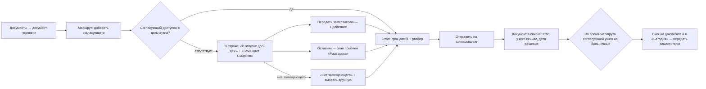
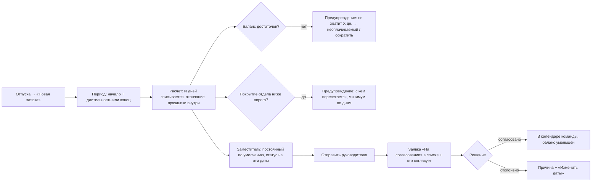

# 02. Пути пользователя и информационная архитектура

## Информационная архитектура

Навигация сгруппирована по рабочим задачам, а не по сущностям. Разделы, недоступные роли, не показываются (не «серые»).

| Группа    | Раздел                     | Роут                           | Сотрудник      | Руководитель | HR                     | Админ    |
| --------- | -------------------------- | ------------------------------ | -------------- | ------------ | ---------------------- | -------- |
| Работа    | Сегодня                    | `/`                            | ✓              | ✓            | ✓                      | ✓        |
| Работа    | Документы                  | `/documents`, `/documents/:id` | ✓              | ✓            | ✓                      | ✓        |
| Работа    | Сроки                      | `/deadlines`                   | ✓              | ✓            | ✓                      | ✓        |
| Люди      | Команда                    | `/team`                        | ✓ (свой отдел) | ✓            | ✓ (все)                | ✓        |
| Люди      | Отпуска                    | `/vacations`                   | ✓              | ✓ + очередь  | ✓ (все заявки, чтение) | ✓        |
| Люди      | Больничные                 | `/sick-leaves`                 | —              | —            | ✓                      | ✓        |
| Настройки | Производственный календарь | `/calendar`                    | чтение         | чтение       | чтение                 | ✓ правка |
| —         | Сотрудник                  | `/employees/:id`               | ✓              | ✓            | ✓                      | ✓        |

Счётчики в навигации (только там, где ждут действия пользователя): «Отпуска · 3» у руководителя (заявки на согласовании), «Больничные · 2» у HR (пересечения без решения), «Документы · 1» (документы, где риск срока у моих маршрутов). Счётчик — нейтральный бейдж, не красный: это работа, а не авария.

**Вход там, где уже есть контекст:** статус человека и заместитель встроены в маршрут документа, заявку, очередь, карточку отдела. Отдельные разделы («Команда», «Сотрудник») — запасной вход и планирование. Глобальный поиск сотрудника в шапке (`⌘K`) — быстрый вход «мне нужен Петров».

## Путь A. Инициатор отправляет документ (ключевой)

Шаги:

1. **Вход.** «Документы» → черновик или кнопка «Новый документ» (демо-СЭД). Запасной: «Сегодня» → «Мои документы на согласовании».
2. **Выбор согласующего.** Комбобокс сотрудников; в каждой опции — статус на даты этапа. Отсутствующий не скрыт и не заблокирован (может быть, его подпись обязательна), но помечен.
3. **Условия до действия.** В строке этапа: статус, заместитель (по цепочке), срок датой, объяснение сдвига.
4. **Действие.** «Передать заместителю» — сразу, без модалки, с «Отменить» в тосте 5 с. Срок пересчитывается на месте.
5. **Результат.** «Отправить на согласование» → документ в статусе «На согласовании», текущий этап и ожидаемая дата решения видны в списке.
6. **Неудача.** Нет замещающего (цепочка пуста или цикл) → красный «Нет замещающего», действия: «Выбрать согласующего» / «Оставить и ждать выхода (до 12 янв.)». Срок за горизонтом календаря (после 2027) → «Не можем посчитать: календарь на 2028 не загружен».

## Путь B. Сотрудник подаёт заявку на отпуск

Правило: предупреждения (часть < 14 дней, конфликт покрытия, баланс) не блокируют отправку — решение за руководителем. Блокируют только ошибки ввода: пустой/обратный период, пересечение с собственной согласованной заявкой.

## Путь C. Руководитель согласует заявки

1. Вход: счётчик в навигации или блок «Ждут вашего решения» на «Сегодня».
2. Очередь: строка = сотрудник, даты, дни, заместитель (со статусом), **покрытие отдела в эти даты** (мин. «3 из 6 · 50%», порог 60%).
3. Простое решение — прямо из строки: «Согласовать» / «Отклонить» (отклонение требует причину — поповер с полем).
4. Спорное — раскрыть строку: мини-таймлайн отдела на период ±3 дня, кто ещё отсутствует.
5. Результат: строка уходит из очереди в «Решённые сегодня» с возможностью отменить решение в течение сессии.

## Путь D. HR регистрирует больничный

1. Вход: «Больничные» → «Открыть больничный».
2. Форма: сотрудник (с текущим статусом), дата начала (по умолчанию сегодня), номер ЭЛН (12 цифр), «Дата окончания неизвестна» включено по умолчанию.
3. До сохранения — блок «Что это задевает»: согласованный отпуск в периоде (ст. 124), этапы документов, где он согласующий, заместитель.
4. Сохранение → больничный «Открыт» в списке; пересечение с отпуском — отдельная плашка с действием «Продлить отпуск на N дн.» / «Перенести» / «Решить позже» (тогда счётчик в навигации).
5. Продлить (новый ЭЛН, новая ожидаемая дата) / Закрыть (дата окончания) → пересчёт пересечения.

## Путь E. Администратор обновляет календарь

1. «Календарь» → год → клик по дню → поповер: тип (рабочий / выходной / праздник), «сокращённый», «перенос», примечание.
2. Сводка года пересчитывается сразу; если рабочих дней ≠ ожидаемому по постановлению — предупреждение «Проверьте: 246 вместо 247».
3. Импорт JSON → предпросмотр различий («изменится 6 дней») → применить.
4. Изменение календаря влияет на сроки и отпуска: показать «Пересчитано: 4 этапа документов, 2 заявки».
